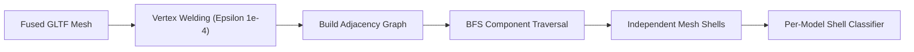
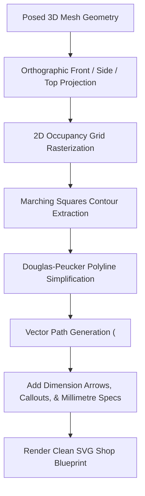

# FurniCraft 3D Studio Engineering Specification

This document details the mathematical, algorithmic, and rendering systems powering FurniCraft's **3D Parametric Furniture Studio**.

---

## 1. Core Philosophy: Why Not Procedural Boxes?

Traditional 3D furniture customizers fall into two flawed extremes:
1. **Procedural Primitive Assembly**: Composing furniture purely out of geometric boxes and cylinders. This yields simplistic, unrealistic designs devoid of organic curvature, carved details, and artisanal joinery.
2. **Fixed GLTF Model Swapping**: Loading pre-baked variations from 3D software. This prevents granular parametric sizing (e.g., custom seat height or leg thickness) and explodes asset storage requirements.

### FurniCraft's Hybrid Approach
FurniCraft loads **high-quality, licensed GLTF/GLB models** (artisan-modeled with authentic joinery, curvature, and proportions), decomposes their meshes into distinct functional shells via graph segmentation, and attaches a **role-based kinematic rig** to enable realistic parametric deformations.

```
┌─────────────────┐       ┌────────────────────────┐       ┌──────────────────────┐
│  Raw GLTF Model │ ----> │ Mesh Segmentation &    │ ----> │ Role-Based Kinematic │
│ (1-2 fused mesh)│       │ Shell Classification   │       │ Rigging & Sizing     │
└─────────────────┘       └────────────────────────┘       └──────────┬───────────┘
                                                                      │
                                   ┌──────────────────────────────────┴──────────────────────────────────┐
                                   ▼                                                                     ▼
                        ┌───────────────────────┐                                             ┌───────────────────────┐
                        │ PBR Material Pipeline │                                             │ Marching Squares 2D   │
                        │ (Texture & Finish)    │                                             │ SVG Blueprint Engine  │
                        └───────────────────────┘                                             └───────────────────────┘
```

---

## 2. Connected-Component Mesh Segmentation (`chair-segmentation.ts`)

When 3D furniture models are exported from Blender or 3ds Max, all wooden components are typically joined into a single monolithic `THREE.Mesh`. Without segmentation, selecting or modifying the chair would apply changes to the entire piece at once.

### The Graph Traversal Algorithm
FurniCraft recovers individual physical pieces through topological connected-component analysis:

1. **Vertex Welding**: Exported meshes frequently split vertices across UV seams or sharp normals. The segmentation engine constructs a welded vertex map where vertices sharing spatial coordinates within an epsilon ($\epsilon = 10^{-4}$) are mapped to a single topological vertex index.
2. **Triangle Adjacency Graph**: A dual graph is built where each triangle is a node, and edges connect triangles sharing at least two welded vertices.
3. **Connected-Component Extraction (BFS)**: Breadth-First Search groups triangles into isolated manifold components ("shells"):
   - Victorian Chair: Decomposes into **35 distinct shells** (4 legs, stretchers, seat frame rails, backrest spindles, crest rail, seat pad).
   - Cushion Chair: Decomposes into **5 distinct shells** (4 legs + 1 molded shell).
   - Rattan Armchair / Patio / Stool: Decomposed into corresponding frame and weave components.



---

## 3. Shell Classification

Once shells are extracted, a classifier function maps each topological shell to a semantic **Part ID** (e.g., `legs`, `seatFrame`, `seatCushion`, `backFrame`).

### Relative Bounding Box Classification
Rather than hardcoding fragile absolute coordinates, classifiers evaluate geometry relative to the overall object bounding box:

$$\text{Normalized } Y = \frac{Y - Y_{\min}}{Y_{\max} - Y_{\min}}$$

For example, in `classifyVictorianShell`:
- Shells with $\text{Normalized } Y < 0.45$ and radial distance from center $> R_{\text{leg}}$ are classified as `legs`.
- Shells at $0.40 \le Y \le 0.52$ forming a closed horizontal perimeter are classified as `seatFrame`.
- Central geometry at $Y \approx 0.50$ is classified as `seatCushion`.
- Upper vertical geometries ($Y > 0.52$) are classified as `backFrame` and `backCrest`.

---

## 4. Role-Based Kinematic Rigging (`chair-rig.ts`)

Resizing furniture is not uniform matrix scaling. Scaling chair legs vertically without adjusting the seat would detach the seat or cause it to float.

### Semantic Part Roles
The rig acts upon abstract **Roles** rather than hardcoded mesh names:

| Part Role | Mechanical Behavior | Kinematic Constraints |
| :--- | :--- | :--- |
| `base` | Legs, feet, casters | Scales vertically and thickens radially; pushes all superior parts upward. |
| `seatFrame` | Structural seat perimeter | Scales in $X$ (width) and $Z$ (depth); shifts corner leg attachment points outward. |
| `seatCushion` | Upholstered seat pad | Plumps upward from seat frame base; inherits width/depth from `seatFrame`. |
| `backFrame` | Backrest uprights/splat | Anchors to rear of `seatFrame`; height stretches upward without distorting seat. |
| `backCushion` | Lumbar pad or cushion | Scales thickness along local normal; conforms to `backFrame` dimensions. |
| `ornament` | Carvings, finials, caps | Translates with parent attachment point without experiencing non-uniform distortion. |

### Constraint Propagation Math
When leg height scale factor $S_{\text{leg}}$ is adjusted:
$$\Delta Y = (S_{\text{leg}} - 1.0) \times H_{\text{leg\_base}}$$
The origin of `seatFrame`, `seatCushion`, and `backFrame` is updated:
$$Y_{\text{new}} = Y_{\text{orig}} + \Delta Y$$

When seat width scale factor $S_{\text{width}}$ is adjusted:
$$\Delta X = (S_{\text{width}} - 1.0) \times \frac{W_{\text{seat}}}{2}$$
Left and right legs translate by $-\Delta X$ and $+\Delta X$ respectively.

---

## 5. Real-World Units & Dimensions (`studio-dimensions.ts`)

Every 3D model is normalized at load time so its bounding box height equals exactly **$1.0 \text{ Three.js unit}$**.

Each model defines its real-world physical baseline in `studio-models.ts` via the `cmPerUnit` constant:
- **Victorian Chair**: `cmPerUnit = 96.0` (baseline height = $96\text{ cm}$)
- **Cushion Tub Chair**: `cmPerUnit = 82.0` (baseline height = $82\text{ cm}$)

### Live Measurement Computation
As the user manipulates parametric sliders, the bounding box is recalculated in world space:
$$\text{Width (cm)} = (X_{\max} - X_{\min}) \times \text{cmPerUnit}$$
$$\text{Height (cm)} = (Y_{\max} - Y_{\min}) \times \text{cmPerUnit}$$
$$\text{Depth (cm)} = (Z_{\max} - Z_{\min}) \times \text{cmPerUnit}$$

These live values feed the on-screen 3D ruler overlay, dimension readout cards, and the shop quotation pipeline.

---

## 6. Two-Tier Material & PBR Finish System

FurniCraft separates visual styling into two orthogonal axes:

```
[ Base Material ]  x  [ Surface Finish ]  =  [ Dynamic Three.MeshStandardMaterial ]
  • Narra Wood          • Raw / Oiled           • Diffuse Map (Albedo)
  • Mahogany            • Hand-Rubbed Wax       • Normal Map (Perturbation)
  • Reeded Cane         • Satin Polyurethane    • Roughness Map (Micro-surface)
  • Synthetic Rattan    • High-Gloss Lacquer    • Metalness / Clearcoat
  • Woven Fabric
```

### Texture Scaling (`uvScale`)
Different 3D models are unwrapped at differing UV densities. To prevent seamless textures from looking stretched or microscopic, each `StudioModel` defines a `uvScale` multiplier:
$$\text{Effective Repeat} = \text{Material Repeat} \times \text{Model } uvScale$$

---

## 7. Realtime 2D SVG Blueprint Engine (`studio-blueprint-svg.ts`)

Shops need a dimensioned technical drawing to build from. FurniCraft generates clean vector shop drawings directly in the browser.



### Marching Squares Contour Tracing
1. The 3D geometry is orthographically projected onto a 2D binary grid.
2. The **Marching Squares** algorithm traces the boundary of the solid silhouette, generating a continuous 2D polygon.
3. The **Douglas-Peucker Algorithm** simplifies the dense polygon into smooth, CAD-like vector outlines by eliminating collinear and redundant vertices within tolerance $\epsilon_{\text{DP}} = 1.5\text{px}$.
4. Dimension lines, centerlines, and furniture shop annotations are injected into a clean, exportable `<svg>` blueprint.

### Callout Placement (`studio-blueprint-callouts.ts`)
The numbered balloons key each part on the views to the component schedule's `#` column. They are placed at render time from data every saved design already carries (the traced outline and each part's bounds and components), so older designs are numbered the same way with nothing new stored.
1. **What is visible.** The outline is rasterised, and each inked cell is given to the part that explains it: the nearest *solid* part hides what is behind it, and among what is left the most specific part wins (a stretcher, not the box of the four legs around it). Sets of pieces (legs, arms, handles, drop leaves) only claim the ends of their box, where their pieces actually sit. A single piece of unknown shape is only allowed to hide what shows no see-through gaps in the outline.
2. **One balloon per part**, in the view that shows it most clearly, spreading balloons across the sheet when views are equally clear. A part hidden in every view gets a dashed leader.
3. **Balloon in clear space.** Candidate spots are scored by leader length, crossings of other parts and dimension lines, and leader-over-leader crossings; the leader runs to the nearest well-inside point of the part and ends in a dot.

---

## 8. Step-by-Step: Adding a New 3D Model

To add a new piece of furniture to the studio:

1. **Place Assets**:
   - Add the `.glb` model to `public/models/<model-name>/model.glb`.
   - Add model thumbnail and `license.txt` (preserving CC attribution).
2. **Define Classifier in `chair-segmentation.ts`**:
   - Write `classify<ModelName>Shell(shellBoundingBox, modelBounds): PartId`.
3. **Register Model in `studio-models.ts`**:
   ```typescript
   export const MY_NEW_MODEL: StudioModel = {
     id: "my-new-chair",
     name: "Modern Dining Chair",
     defaultProjectName: "Custom Dining Chair",
     url: "/models/my-new-chair/model.glb",
     cmPerUnit: 88.0,
     classify: classifyMyNewChairShell,
     resolveSurface: myNewChairSurfaceResolver,
     parts: MY_NEW_CHAIR_PARTS,
     uvScale: 1.0,
     icon: "armchair",
     credit: "Model by ArtistName (CC-BY-4.0)",
   };
   ```
4. **Define Config & Sliders**:
   - List the parts and attachable control sliders (`controls: [{ key: 'legHeight', min: 0.8, max: 1.3 }]`).
