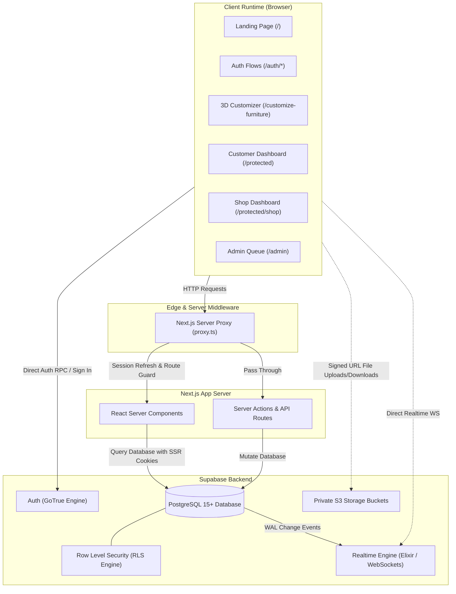
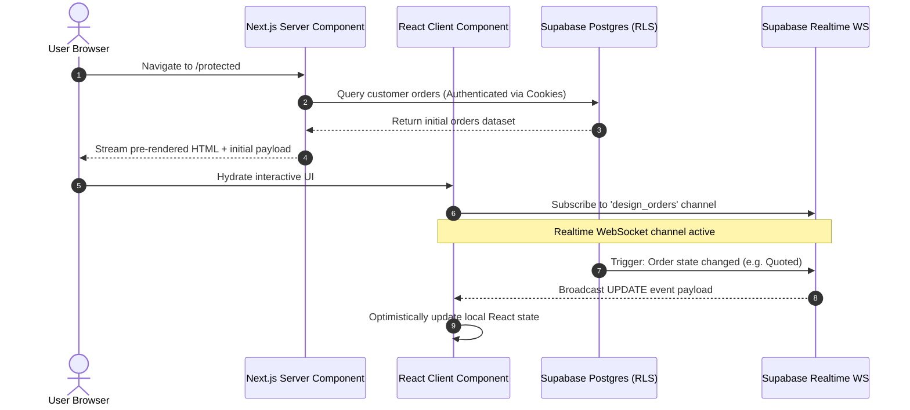

# FurniCraft System Architecture

This document provides a comprehensive technical overview of the system architecture, directory topology, cross-cutting patterns, and runtime communication layers powering **FurniCraft**.

---

## 1. High-Level Architecture Overview

FurniCraft is designed as a hybrid Server-Rendered / Client-Interactive application built with **Next.js 16 (App Router)** and backed by **Supabase (PostgreSQL, Auth, Storage, and Realtime)**.



---

## 2. Directory Structure

```
furnicraft-v4/
├── app/                              # Next.js App Router root
│   ├── admin/                        # Admin verification queue (/admin)
│   ├── auth/                         # Authentication pages (sign-in, sign-up, forgot-pw, etc.)
│   ├── customize-furniture/          # 3D Studio customizer workspace
│   ├── order-summary/                # Checkout & shop submission page
│   ├── protected/                    # Customer authenticated dashboard
│   │   ├── orders/                   # Customer order views
│   │   └── shop/                     # Shop owner dedicated portal (/protected/shop)
│   ├── shops/                        # Public shop storefront directory
│   ├── layout.tsx                    # Root layout with fonts, metadata, and theme
│   ├── page.tsx                      # Public landing page
│   └── globals.css                   # Global CSS, variables, and typography
├── components/                       # Modular UI components
│   ├── admin/                        # Admin approval panels & report handlers
│   ├── auth/                         # Sign-in, sign-up, password forms
│   ├── dashboard/                    # Customer dashboard widgets & navigation
│   ├── design/                       # 3D Studio components & Three.js canvas
│   │   └── studio/                   # Rig, segmentation, blueprint, and materials
│   ├── notifications/                # Realtime notification bell & dropdown
│   ├── orders/                       # Order timeline, state cards, quote/receipt modals
│   ├── reviews/                      # Shop review forms & star rating cards
│   ├── shops/                        # Storefront profile editors, gallery, QR setup
│   ├── solihiya/                     # Heritage design patterns & decorative assets
│   ├── theme/                        # Dark/light theme providers & toggles
│   └── ui/                           # Radix/Tailwind reusable UI primitives
├── docs/                             # Full technical & user documentation
├── lib/                              # Shared utility libraries
│   ├── supabase/                     # Supabase clients (client, server, proxy)
│   ├── commission-path.ts            # Shop commission routing helpers
│   ├── deep-link.ts                  # Notification & card deep-link resolution
│   ├── image-utils.ts                # Client-side image compression & formatters
│   ├── presence.ts                   # Realtime user presence tracking
│   ├── time-ago.ts                   # Relative timestamp formatters
│   └── utils.ts                      # CSS class concatenation (cn)
├── public/                           # Static assets
│   ├── models/                       # GLTF 3D models (Victorian, Cushion, Rattan, etc.)
│   └── textures/                     # PBR texture maps (diffuse, normal, roughness)
├── supabase/                         # Supabase configuration & migrations
│   ├── migrations/                   # Sequential SQL migration files
│   └── config.toml                   # Local Supabase CLI configuration
├── proxy.ts                          # Next.js 16 Request Proxy (middleware)
├── package.json                      # Project dependencies & scripts
└── tailwind.config.ts                # Tailwind design system configuration
```

---

## 3. Server-Side Routing & Proxy Layer (`proxy.ts`)

Next.js 16 utilizes `proxy.ts` (the evolution of Edge middleware) to intercept requests before rendering. 

### Core Responsibilities:
1. **Session Refresh**: Automatically refreshes expired JWT tokens using `@supabase/ssr` `createServerClient` and persists refreshed auth cookies onto the response.
2. **Route Guards**:
   - `/protected/*` and `/admin/*` require an active Supabase Auth session. Unauthenticated users are redirected to `/auth/login`.
   - `/auth/login` and `/auth/sign-up` redirect already-authenticated users directly to `/protected`.
3. **Admin Authorization**:
   - Access to `/admin` checks `user_profiles.is_admin = true`. Unauthorized users receive a `404 Not Found` response rather than a redirect, preventing information disclosure regarding the existence of administrative surfaces.

---

## 4. The Dual-Role Isolation Architecture

A core design requirement of FurniCraft is that a single user account can act as both a **Customer** and a **Shop Owner** without account switching or confusing role toggles.

### Why Surface Separation Matters
In typical applications, dynamic role toggles (`if (user.isShopOwner)`) lead to permission leakage and state bugs (e.g., shop owners browsing other shops seeing their own shop inbox or missing unread badges).

### FurniCraft's Dual-Surface Model:
- **Customer Surface (`/protected`)**:
  - Treats the user strictly as a customer.
  - Lists orders where `customer_user_id = auth.uid()`.
  - Scopes messages to customer conversations with external shops.
  - Never displays the user's own shop in customer-facing shop lists.
- **Shop Surface (`/protected/shop`)**:
  - Treats the user strictly as a shop owner.
  - Displays incoming orders where `shop_id` belongs to `owner_user_id = auth.uid()`.
  - Scopes inbox to incoming customer inquiries.
  - Surfaces shop configuration (payment QR, gallery, published templates).

```
┌────────────────────────────────────────────────────────┐
│                   Single Auth User                     │
│               (auth.users id = 'usr_123')              │
└───────────────┬────────────────────────┬───────────────┘
                │                        │
       Visits /protected        Visits /protected/shop
                │                        │
                ▼                        ▼
     [Customer Context]           [Shop Context]
  • Orders: customer_id = usr_123 • Orders: shop.owner = usr_123
  • Messages: signed as 'customer'• Messages: signed as 'shop_owner'
  • Storefronts: Other shops      • Storefronts: Manage own shop
```

---

## 5. Client vs. Server Data Boundaries



---

## 6. Storage Security Model

FurniCraft uses Supabase Storage with strict private access policies:

| Bucket Name | Purpose | Visibility | Access Policy |
| :--- | :--- | :--- | :--- |
| `seller-documents` | BIR certificates, Valid IDs | **Private** | Read: Shop owner & Admins only.<br/>Write: Shop owner during onboarding. |
| `shop-payment-qr` | Shop GCash / QR Ph images | **Private** | Read: Shop owner & Customers with active orders.<br/>Write: Shop owner. |
| `payment-receipts` | Customer payment proof screenshots | **Private** | Read: Customer who uploaded & Shop owner receiving payment.<br/>Write: Customer on confirmed orders. |

> [!IMPORTANT]
> All storage objects are retrieved via **Time-Limited Signed URLs** generated server-side. File URLs are never hardcoded or made publicly readable.
