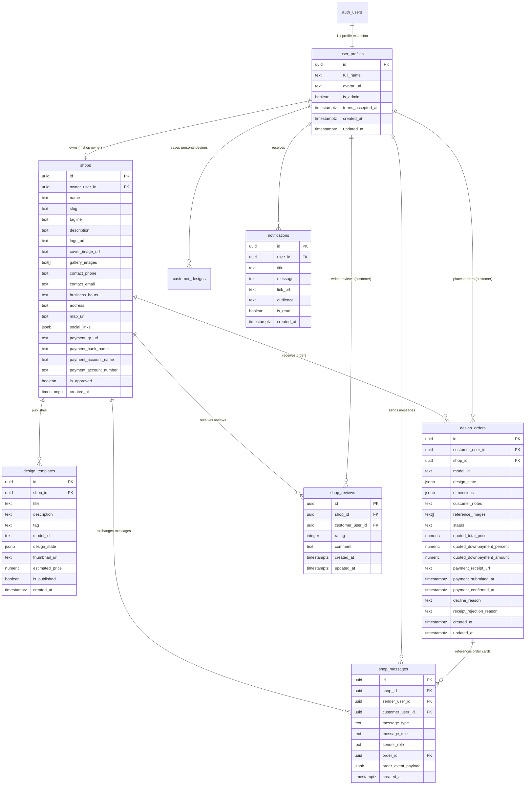

# FurniCraft Database & Security Specification

This document details the PostgreSQL database schema, Entity Relationship Diagrams (ERD), Row Level Security (RLS) policies, database triggers, security definer views, and access control models implemented in **FurniCraft**.

---

## 1. Entity Relationship Diagram (ERD)

---

## 2. Table Schemas & Constraints

### 2.1 `user_profiles`
Extends `auth.users` with display metadata and authorization flags.
- `id` (UUID, PK, FK -> `auth.users.id` ON DELETE CASCADE)
- `full_name` (TEXT)
- `avatar_url` (TEXT)
- `is_admin` (BOOLEAN, DEFAULT `false`): Governs access to `/admin`. Guarded by trigger `guard_admin_flag` to block client self-promotion.
- `terms_accepted_at` (TIMESTAMPTZ)

### 2.2 `shops`
Storefront configuration, branding, and direct payment credentials.
- `id` (UUID, PK, DEFAULT `gen_random_uuid()`)
- `owner_user_id` (UUID, FK -> `user_profiles.id`, UNIQUE)
- `name` (TEXT, NOT NULL)
- `slug` (TEXT, UNIQUE, NOT NULL)
- `tagline`, `description`, `logo_url`, `cover_image_url`
- `gallery_images` (TEXT ARRAY)
- `contact_phone`, `contact_email`, `business_hours`, `address`, `map_url`
- `social_links` (JSONB): e.g., `{"facebook": "...", "instagram": "..."}`
- `payment_qr_url`, `payment_bank_name`, `payment_account_name`, `payment_account_number`
- `is_approved` (BOOLEAN, DEFAULT `false`): Granted exclusively by admin approval.

### 2.3 `design_orders`
The core transactional contract between a customer and a furniture shop.
- `id` (UUID, PK)
- `customer_user_id` (UUID, FK -> `user_profiles.id`)
- `shop_id` (UUID, FK -> `shops.id`)
- `model_id` (TEXT, NOT NULL): Identifies base 3D model (e.g., `victorian-chair`).
- `design_state` (JSONB, NOT NULL): Full parametric state (sizes, parts, finishes).
- `dimensions` (JSONB): Measured width, height, depth in centimetres.
- `status` (TEXT, NOT NULL): 7-state lifecycle managed by `guard_design_order_columns`.
- `quoted_total_price` (NUMERIC)
- `quoted_downpayment_percent` (NUMERIC, CHECK `quoted_downpayment_percent >= 5`)
- `quoted_downpayment_amount` (NUMERIC, GENERATED ALWAYS AS `round(quoted_total_price * quoted_downpayment_percent / 100, 2)`)
- `payment_receipt_url` (TEXT)
- `decline_reason` (TEXT)
- `receipt_rejection_reason` (TEXT)

### 2.4 `shop_messages` & `conversation_read_state`
Realtime customer-to-shop chat and automated order event cards.
- `shop_id` (UUID, FK -> `shops.id`)
- `customer_user_id` (UUID, FK -> `user_profiles.id`)
- `sender_user_id` (UUID, FK -> `user_profiles.id`)
- `sender_role` (TEXT, CHECK `sender_role IN ('customer', 'shop_owner')`)
- `message_type` (TEXT, CHECK `message_type IN ('text', 'order_event')`)
- `order_id` (UUID, FK -> `design_orders.id` ON DELETE SET NULL)
- `order_event_payload` (JSONB): Stores deep-link metadata and status transition snapshots.

---

## 3. Row Level Security (RLS) Architecture

Since the Supabase publishable key is bundled client-side in the browser, **all access control invariants are enforced inside PostgreSQL via RLS policies and triggers**.

### 3.1 Security Principles
1. **Never Trust the Client**: UI disabled states and client-side role assertions are purely cosmetic.
2. **Strict Identity Binding**: Policies match `auth.uid()` against ownership foreign keys.
3. **No Blind Permissive Rules**: All tables reject queries by default (`ENABLE ROW LEVEL SECURITY`).
4. **Column Write Protection**: PostgreSQL RLS operates on rows. Column-level restrictions (e.g., preventing customers from editing `is_admin` or `quoted_total_price`) are enforced via `BEFORE UPDATE` triggers.

---

## 4. Key Triggers & Security Definer Functions

### 4.1 `guard_design_order_columns`
Enforces the 7-state order lifecycle state machine. Rejects invalid state transitions and restricts column mutations based on whether the caller is the customer or the shop owner.

### 4.2 `guard_admin_flag`
Ensures that only an existing admin or a backend service role can modify the `is_admin` flag on `user_profiles`.

### 4.3 `emit_order_event_message`
Triggered on `design_orders` state changes. Automatically formats and inserts an interactive order card into the `shop_messages` thread.

### 4.4 `handle_new_user`
`SECURITY DEFINER` trigger listening to `auth.users` `AFTER INSERT`. Automatically creates a synchronized row in `public.user_profiles`.

---

## 5. Security Definer Views

To prevent customer/shop privacy leaks while allowing the UI to display participant names without opening raw tables:

| View Name | Security Level | Purpose |
| :--- | :--- | :--- |
| `user_display_names` | `SECURITY DEFINER` | Exposes only `id` and `full_name` for peer lookup in chat and orders. Strips sensitive profile columns. |
| `shops_public` | `SECURITY DEFINER` | Exposes public storefront metadata for approved shops while masking private payment details until an order is confirmed. |
| `shop_ratings` | `SECURITY INVOKER` | Aggregates average star rating and review count per shop. |
