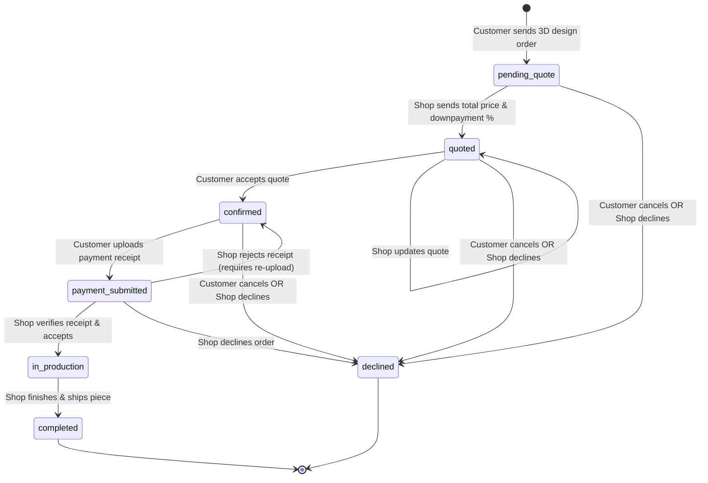
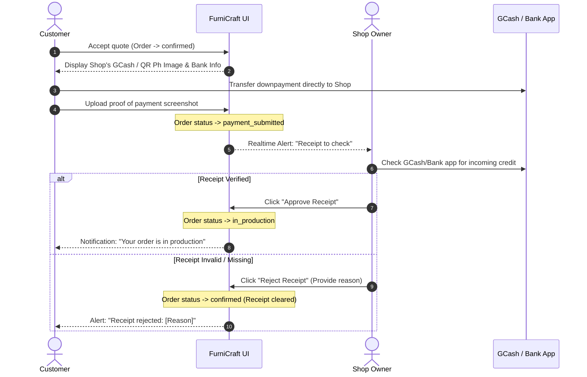

# FurniCraft Order Lifecycle & State Machine

This document details the transactional state machine governing the relationship between customers and furniture shops in **FurniCraft**.

---

## 1. The 7-State Lifecycle State Diagram



---

## 2. Order States & Human-Readable Semantics

| State (`status`) | UI Badge Label | Customer Hint | Shop Owner Hint |
| :--- | :--- | :--- | :--- |
| `pending_quote` | **Needs quote** | Waiting for the shop to price your design. | Send the customer a price and downpayment. |
| `quoted` | **Quoted** | Review the quote and confirm or decline it. | Waiting for the customer to accept your quote. |
| `confirmed` | **Downpayment due** | Pay the downpayment with the shop's QR, then upload receipt. | Waiting for customer to pay and upload receipt. |
| `payment_submitted` | **Receipt to check** | The shop is checking your payment. | Check your GCash/bank app, then approve or reject. |
| `in_production` | **In production** | Your piece is being built. | Building. Mark completed when it ships. |
| `completed` | **Completed** | Done — you can leave the shop a review. | Done. |
| `declined` | **Declined** | No longer active. | No longer active. |

---

## 3. Transition Authority: Database Guard (`guard_design_order_columns`)

State transitions are not governed by client-side logic. The PostgreSQL trigger function `guard_design_order_columns` strictly validates the caller's role against an allowed transition matrix before committing changes:

### Allowed Transitions by Role

```
┌────────────────────────────────────────┬────────────────────────────────────────┐
│             Shop Owner                 │                Customer                │
├────────────────────────────────────────┼────────────────────────────────────────┤
│ pending_quote     --> quoted           │ pending_quote     --> declined         │
│ pending_quote     --> declined         │ quoted            --> confirmed        │
│ quoted            --> quoted (requote) │ quoted            --> declined         │
│ quoted            --> declined         │ confirmed         --> payment_subm.    │
│ payment_submitted --> in_production    │ confirmed         --> declined         │
│ payment_submitted --> confirmed (reject│                                        │
│ payment_submitted --> declined         │                                        │
│ in_production     --> completed        │                                        │
└────────────────────────────────────────┴────────────────────────────────────────┘
```

> [!CAUTION]
> A customer **cannot** mark an order `in_production` or `completed`.
> A shop owner **cannot** accept a quote or submit a receipt on behalf of a customer.
> Attempting an unauthorized transition triggers an immediate PostgreSQL exception (`RAISE EXCEPTION`), which is caught and surfaced directly in the UI.

---

## 4. Payment Model: Direct QR & Manual Verification

FurniCraft avoids third-party payment gateway fees and compliance hurdles by employing a **Direct QR Transfer** model:



---

## 5. Cancellation & Decline Rules

1. **Customer Pre-Payment Cancellation**:
   - Customers may cancel their order at any point before money is transferred (`pending_quote`, `quoted`, `confirmed`).
2. **Post-Payment Cancellation Guard**:
   - Once an order reaches `payment_submitted` or `in_production`, the customer **cannot** unilaterally cancel in the UI. Cancellation requires a direct conversation with the shop owner to arrange a refund.
3. **Decline Reasons**:
   - When a shop declines an order or rejects a receipt, they can submit an explanation string (`decline_reason` or `receipt_rejection_reason`), which is stored on the order and published directly into the chat thread.

---

## 6. Realtime Chat Order Cards (`emit_order_event_message`)

Whenever an order changes state, the database trigger `emit_order_event_message` automatically synthesizes an **Interactive Order Card** inside the `shop_messages` thread:

- **Order Snapshot**: Displays miniature thumbnail, model name, and dimensions.
- **Quote / Payment Status**: Displays latest price, downpayment status, or rejection notices.
- **Deep Links**:
  - `[View Order Details]` -> Links to `/protected/orders/[id]`
  - `[Open 3D Design in Studio]` -> Loads the exact parametric JSON snapshot back into `/customize-furniture` for instant inspection.
