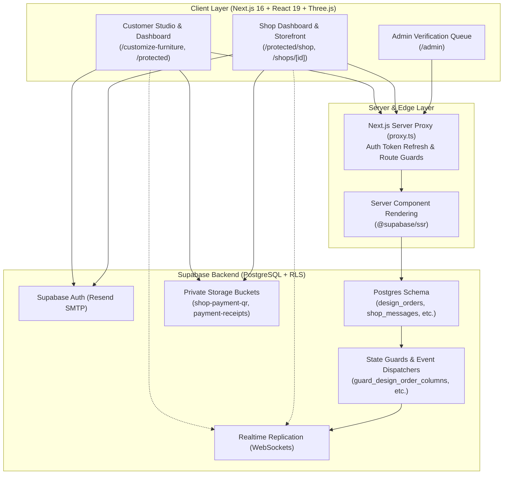

# FurniCraft Documentation Hub

Welcome to the comprehensive technical and operational documentation for **FurniCraft** — a custom 3D furniture design studio, shop marketplace, and direct-to-furniture-shop manufacturing platform.

---

## 📚 Documentation Index

| Document | Description | Target Audience |
| :--- | :--- | :--- |
| [**System Architecture**](./ARCHITECTURE.md) | High-level system design, Next.js 16 App Router, dual-role isolation, realtime channels, storage, and authentication. | Architects, Full-Stack Engineers |
| [**3D Studio Engineering**](./3D_STUDIO_ENGINEERING.md) | Deep dive into 3D mesh segmentation, vertex welding, role-based rigging, PBR materials, and Marching Squares SVG blueprints. | 3D Graphics Engineers, Frontend Developers |
| [**Database & Security**](./DATABASE_AND_SECURITY.md) | Database schema, Entity Relationship Diagrams (ERD), Row Level Security (RLS) policies, triggers, and security definer functions. | Backend Developers, DBA, Security Auditors |
| [**Order Lifecycle & State Machine**](./ORDER_LIFECYCLE_STATE_MACHINE.md) | 7-state order lifecycle, state transition guards, direct QR payment flow, cancellation/rejection handling, and automated event cards. | Product Managers, Backend & Frontend Developers |
| [**Developer Guide**](./DEVELOPER_GUIDE.md) | Local environment setup, Supabase CLI commands, migration workflows, model asset integration, testing, and deployment. | Contributors, Maintainers, DevOps |
| [**User & Administrator Manual**](./USER_AND_ADMIN_MANUAL.md) | Step-by-step operational guide for Customers, Shop Owners, and Platform Administrators. | End Users, Support Teams, Capstone Reviewers |

---

## 🌟 System Overview

FurniCraft eliminates the communication gap between customers seeking custom furniture and local woodworking shops. Instead of describing bespoke furniture over informal chat apps with ambiguous photos, customers configure true 3D models with parametric dimensions, material finishes, and real-time dimensioned blueprints that shops can directly build from.

---

## 🛠️ Key Technology Stack

- **Framework**: [Next.js 16](https://nextjs.org/) (App Router, Turbopack, React Server Components)
- **UI & Styling**: [React 19](https://react.dev/), [Tailwind CSS](https://tailwindcss.com/), Radix UI primitives, Lucide React
- **3D Graphics & Math**: [Three.js](https://threejs.org/) (Custom mesh segmentation, Douglas-Peucker simplification, Marching Squares)
- **Database & Auth**: [Supabase](https://supabase.com/) (PostgreSQL 15+, Row Level Security, Realtime, S3-compatible Storage)
- **Email Infrastructure**: [Resend SMTP](https://resend.com/) for transactional email delivery
- **Type Safety**: Full-stack TypeScript

---

## 🔒 Core Architectural Principles

1. **The Design Is The Order**: Designs serialize as parametric JSON snapshots rather than static screenshots, allowing full bidirectional round-tripping into the 3D Studio.
2. **Database Is The Authority**: Row Level Security (RLS) and database triggers (`guard_design_order_columns`, `guard_notification_update`) enforce access control and state transitions at the PostgreSQL level.
3. **Strict Dual-Role Separation**: Customer and Shop surfaces never overlap (`/protected` vs `/protected/shop`), eliminating permission bleed for dual-role users.
4. **Direct QR Payments**: Zero intermediary transaction fees. Customers pay furniture shops directly via GCash/QR Ph, and furniture shops manually verify bank receipts before starting production.
